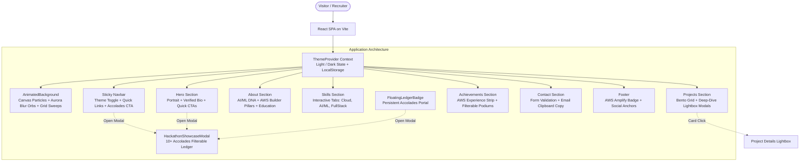

# Ayush Kumar — Developer Portfolio

> **Production Developer Portfolio** engineered with **React 19, TypeScript, Vite, Tailwind CSS v4**, and dual-theme (White / Dark) architecture, optimized for automated CI/CD deployment on **AWS Amplify**.


---

## 👨‍💻 Developer Profile

- **Name**: Ayush Kumar
- **Role**: AI/ML Systems Engineer & AWS Student Builder Group Leader
- **Education**: B.Tech in Computer Science & Engineering (Specialization in AI & ML), Amity University Patna (2022–2026)
- **Email**: [ayushdham405@gmail.com](mailto:ayushdham405@gmail.com)
- **GitHub**: [github.com/Ayushkumar2212](https://github.com/Ayushkumar2212)
- **LinkedIn**: [linkedin.com/in/ayush-kumar-cb221207](https://www.linkedin.com/in/ayush-kumar-cb221207/)

---

## 🏆 Hallmark Accolades & Leadership

| Category | Honor / Role | Organization / Venue | Year |
| :--- | :--- | :--- | :--- |
| **Industry Experience** | **Internship at AWS** | Amazon Web Services (AWS) | 2024 - 2025 |
| **Community Leadership** | **AWS Student Builder Group Leader** | AWS Developer Community | 2024 - Present |
| **Campus Leadership** | **AWS Student Builder Campus Leader** | Amity University Patna Chapter | 2023 - Present |
| **State Leadership** | **Core Team Member** | AWS User Group Team Bihar | 2023 - Present |
| **Advocacy** | **HackerRank Campus Ambassador** | HackerRank | 2023 - Present |
| **Hackathon 1st Prize** | **Winner (1st Place)** | Techphilia 9.0 Hackathon, Amity Patna | 2026 |
| **National Hackathon** | **3rd Position Podium** | Internal Smart India Hackathon (SIH'26) | 2026 |
| **Design & Code** | **3rd Position Podium** | UXATHON, Tech Mahotsav'26, HnCC BIT Sindri | 2026 |
| **Inter-College** | **3rd Position Podium** | Technova Hackathon (Aagman), Impact Colleges | 2026 |
| **Research Paper** | **3rd Position & Paper Presenter** | NCICIR-2026, ISM Patna (*SafeScript AI*) | 2026 |
| **National Benchmark** | **4th Position (AIR 4)** | EFOS Skill Up India (out of 10,000+ engineers) | 2024 |
| **National AI Sprint** | **Semi-Finalist** | ET-AI Hackathon 2026, The Economic Times Digital | 2026 |
| **Inter-IIT Challenge** | **Round 2 Qualifier** | Vittarth 2.0 (IIT Roorkee, KGP, Delhi, Bombay, GHY) | 2025 - 2026 |
| **Innovation Sprint** | **Top 10 National Finalist** | IIT Kharagpur FUGACITY (*AyurVed*) | 2024 |

---

## 📐 Architecture Flowchart

### 1. System Interaction Flow



---

### 2. AWS Amplify CI/CD Deployment Pipeline

```mermaid
flowchart LR
    Dev[Local Development\nCode & Test] -->|git push origin main| GitHub[GitHub Repository\nAyushkumar2212/portfolio]
    
    subgraph AWSAmplify [AWS Cloud Architecture]
        Hook[Amplify Webhook Trigger]
        BuildContainer[Amplify Build Container\nNode 20+ Runtime]
        NpmInstall[npm ci / npm install]
        NpmBuild[npm run build\nVite + Tailwind 4 Compiler]
        DistArtifacts[Artifact Verification\n/dist Directory]
        CloudFront[Amazon CloudFront CDN\nGlobal Edge Distribution & SSL]
        S3Hosting[Amazon S3 Storage\nStatic Web Assets Bucket]
    end
    
    GitHub --> Hook
    Hook --> BuildContainer
    BuildContainer --> NpmInstall
    NpmInstall --> NpmBuild
    NpmBuild --> DistArtifacts
    DistArtifacts --> S3Hosting
    S3Hosting --> CloudFront
    CloudFront --> EndUser([Global Visitors <50ms Latency])
```



---

### 3. Text/ASCII Architecture Flowchart

```
+-----------------------------------------------------------------------------------------+
|                                    AYUSH KUMAR PORTFOLIO                                 |
+-----------------------------------------------------------------------------------------+
                                             |
                                    [ ThemeProvider ]
                          (Controls .dark / .light on <html>)
                                             |
          +----------------------------------+----------------------------------+
          |                                  |                                  |
 [ AnimatedBackground ]             [ Sticky Navbar ]                 [ FloatingBadge ]
  * Canvas particle network          * Wordmark                        * Quick Ledger CTA
  * Aurora floating orbs             * Light/Dark toggle               * Verified badge
  * Grid beam sweep lines            * 8+ Hackathons CTA               * One-click trigger
          |                                  |                                  |
          +----------------------------------+----------------------------------+
                                             |
                         +-------------------+-------------------+
                         |                                       |
                   [ Hero Section ]                      [ About Section ]
                    - Portrait frame (object-top)         - Amity Univ Patna
                    - AWS Intern & Lead bio               - AI/ML Specialization
                    - CTAs (Projects, GitHub, LinkedIn)   - Hackathon & Cloud DNA
                         |                                       |
                   [ Skills Section ]                    [ Projects Bento ]
                    - Cloud & DevOps (AWS)                - SafeScript AI (NCICIR)
                    - AI/ML & Vision (OpenCV)             - AyurVed (IIT Kharagpur)
                    - Full Stack (React/Next)             - AI Kiosk (SIH'26)
                         |                                - Prompt2Pixel (AWS Lead)
                         |                                       |
               [ Achievements Section ]                 [ Contact & Footer ]
                - AWS Internship & Leaderships           - Live form validation
                - SIH'26, Techphilia 9.0 1st             - Copy email action
                - BIT Sindri, Technova, Vittarth         - "Hosted on AWS Amplify"
                         |
           +-------------+-------------+
           |                           |
[ Hackathon Ledger Modal ]   [ Project Detail Modal ]
  - Filter by category        - Architecture points
  - Problem & Solution        - Performance metrics
  - Jury & Impact metrics     - Live demo & source links
```

---

## 🛠️ Tech Stack & Libraries

- **Framework**: [React 19](https://react.dev/) + [Vite 6](https://vitejs.dev/)
- **Language**: [TypeScript 5](https://www.typescriptlang.org/)
- **Styling**: [Tailwind CSS v4](https://tailwindcss.com/) with `@custom-variant dark` support
- **Icons**: [lucide-react](https://lucide.react.dev/)
- **Animations**: Native Web Canvas + GPU Compositor CSS Keyframes
- **Deployment**: [AWS Amplify Hosting](https://aws.amazon.com/amplify/hosting/) with SSL & Global CDN

---

## 📂 Project Directory Structure

```text
├── index.html                   # HTML entry point with dual-theme classes & fonts
├── metadata.json                # Project identity metadata
├── package.json                 # Dependencies & build scripts
├── tsconfig.json                # Strict TypeScript configuration
├── vite.config.ts               # Vite bundler config with path aliases
├── public/                      # Static assets served at root
│   └── assets/aistudio/
│       └── Ayush_Photo_d280ad26.jpeg  # Ayush Kumar professional portrait
├── src/
│   ├── main.tsx                 # React DOM mount point
│   ├── App.tsx                  # Root component wrapping ThemeProvider
│   ├── index.css                # Tailwind 4 styles, fonts & keyframes
│   ├── context/
│   │   └── ThemeContext.tsx     # Light/Dark mode state & localStorage persistence
│   ├── data/
│   │   └── portfolioData.ts     # Data model for projects, skills, leadership & accolades
│   ├── assets/
│   │   └── images/              # High-fidelity project showcase previews
│   └── components/
│       ├── AnimatedBackground.tsx   # Floating aurora orbs & constellation canvas
│       ├── Navbar.tsx               # Top bar with theme toggle & social links
│       ├── Hero.tsx                 # Hero section with portrait & CTAs
│       ├── About.tsx                # Background, CS degree & engineering pillars
│       ├── Skills.tsx               # Interactive skills matrix with filter tabs
│       ├── Projects.tsx             # Bento grid projects & deep-dive modal
│       ├── Achievements.tsx         # AWS leadership & competition podiums
│       ├── HackathonShowcaseModal.tsx # Filterable 10+ entry accolades ledger
│       ├── FloatingLedgerBadge.tsx  # Floating shortcut badge for accolades
│       ├── Contact.tsx              # Interactive contact form & email copy
│       └── Footer.tsx               # Footer with AWS Amplify badge
└── README.md                    # Project documentation & setup guide
```

---

## 🚀 Local Development Setup

### Prerequisites
- Node.js `v18.0.0` or higher
- npm `v9.0.0` or higher

### Steps

1. **Clone the repository**:
   ```bash
   git clone https://github.com/Ayushkumar2212/portfolio.git
   cd portfolio
   ```

2. **Install dependencies**:
   ```bash
   npm install
   ```

3. **Start the development server**:
   ```bash
   npm run dev
   ```
   Open [http://localhost:3000](http://localhost:3000) in your browser.

4. **Verify TypeScript compilation & linting**:
   ```bash
   npm run build
   ```

---

## ☁️ Deploying to AWS Amplify (Step-by-Step)

### Method 1: Git-Connected Automated CI/CD (Recommended)

1. **Push your code to GitHub**:
   ```bash
   git init
   git add .
   git commit -m "feat: complete developer portfolio with dual theme and accolades"
   git branch -M main
   git remote add origin https://github.com/Ayushkumar2212/<your-repo-name>.git
   git push -u origin main
   ```

2. **Open AWS Amplify Console**:
   - Go to [AWS Management Console](https://console.aws.amazon.com/amplify/).
   - Click **"Create new app"** -> **"Host web app"**.
   - Select **GitHub** as the source repository and authorize AWS Amplify.

3. **Configure Build Settings**:
   Amplify will automatically detect Vite. The build specification (`amplify.yml`) will look like:
   ```yaml
   version: 1
   frontend:
     phases:
       preBuild:
         commands:
           - npm ci
       build:
         commands:
           - npm run build
     artifacts:
       baseDirectory: dist
       files:
         - '**/*'
     cache:
       paths:
         - node_modules/**/*
   ```

4. **Save & Deploy**:
   - Click **Save and Deploy**.
   - Amplify will provision the build environment, execute `npm run build`, and distribute the application globally across Amazon CloudFront CDN edge locations with automatic SSL certificates.

---

## 📄 License

This portfolio is open-source and released under the [MIT License](LICENSE).
Designed and maintained by **Ayush Kumar** (Amity University Patna).
